# cinegrain 2 - Let's make some more noise!

<p align="left">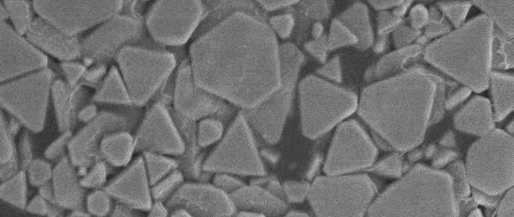</p>

Realistic film grain for [mpv](https://mpv.io), with a five-zone equalizer that shapes the grain over the brightness range, the way real film stock does.

> **cinegrain 2 replaces [cinegrain](https://github.com/mr-berndt/cinegrain).** The original shader still works, but it is no longer developed.

---

## Latest update – 12 October 2026

I further improved the grain synthesizer and also made the user-values more meaningful. Also the values now directly correspond to actual grey card scans. Level 1 now matches the grain strength of the grey-card scans at every size. You can switch between sizes on the fly and the grain stays true to the film, without having to readjust the level every time.

The new grain synthesis now matches the original scans close enough to make it extremely difficult to tell the synthetic grain and the real thing apart. Finally!

[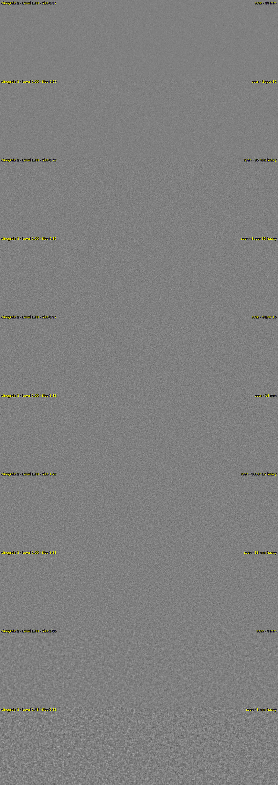](https://raw.githubusercontent.com/mr-berndt/cinegrain2/main/images/grain-vs-scans.png)

*Left: cinegrain 2, right: ProRes 4K DCI scans of real grain on a 50 % grey card, 1:1 crops, seamlessly joined. Only the mean brightness of each half is matched, the grain strength is not. Reference scans: free DCI 4K film grain plates from [tdcat.com](https://tdcat.com/downloads/filmgrain).*

*Click on the image to load it in full size. The preview here is scaled down and hides the grain. If your browser fits the image to the window, click it once more to see it at 100 %.*

What changed under the hood:

- **Grain shape.** Real grain is not just blurred noise. Its coarse structure is missing: the crystals sit evenly side by side. Plain blurred noise keeps that coarse structure and shows it as faint bright and dark blotches that change with every frame, three to eight times stronger than in the scans. cinegrain 2 now subtracts a wide copy of the grain from itself, fitted to the power spectra of ten grain scans from 8 mm to 35 mm. They all share the same shape.
- **Level in real units.** Level 1.0 is the grain strength of the scans on a 50 % grey card, for every Size.
- **Display resolution.** Size is defined at 2160p. On a smaller output, fine grain is attenuated the way a 4K scan would be when brought down to that resolution (mpv's default downscaler); coarse grain is kept. At 2160p and above nothing is attenuated.
- **Equalizer at mid grey.** The zone curve is normalised to 1 at 50 % grey, the brightness of the scans, so the zones only shape the grain relative to mid grey and never change what Level means.
- **Monochrome.** The scans have no colour grain, so neither does cinegrain 2 by default.

## Why a second version

Watching films with the original cinegrain, I kept running into films whose grain looked very different from mine. The difference was easy to spot once I looked for it: **Aliens** is outright dirty in the lower brightness region and almost clean above mid brightness, while the TV show **Lost** has grain all the way up into the brightest parts of the picture and is rather clean at the bottom end.

| Aliens (1986): heavy grain in the shadows, clean highlights | Lost (2004): grain right up to the white sky |
|---|---|
| [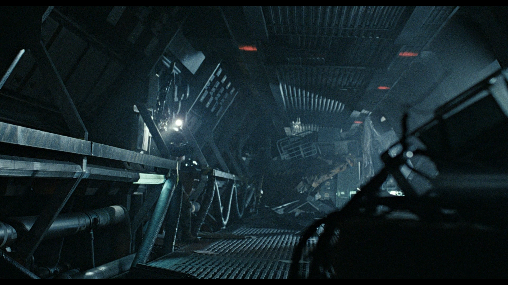](https://raw.githubusercontent.com/mr-berndt/cinegrain2/main/images/aliens-1986-original.png) | [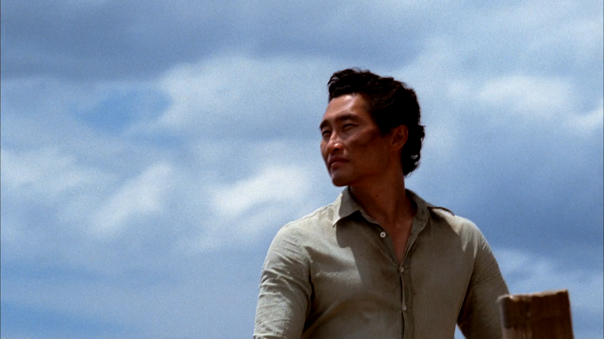](https://raw.githubusercontent.com/mr-berndt/cinegrain2/main/images/lost-s01e24-original.png) |
| [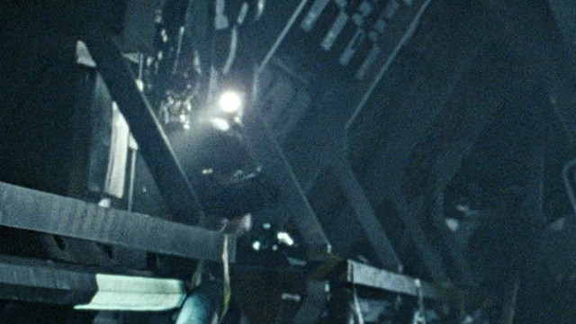](https://raw.githubusercontent.com/mr-berndt/cinegrain2/main/images/aliens-1986-crop-bright.png) | [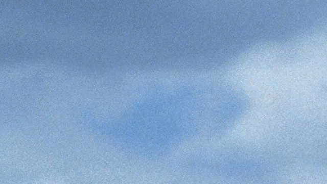](https://raw.githubusercontent.com/mr-berndt/cinegrain2/main/images/lost-s01e24-crop-sky.png) |

*Top: full 1080p frames. Bottom: 1:1 crops, no scaling. Both without any synthetic grain. Click an image to load it in full size.*

Analyzing some more films showed what was going on: the intensity of real grain varies wildly along the brightness axis. The reasons are well known once you dig into it: different film stocks, and different ways of exposing and developing them. Here are the approximate grain curves of six films. They have little in common:

[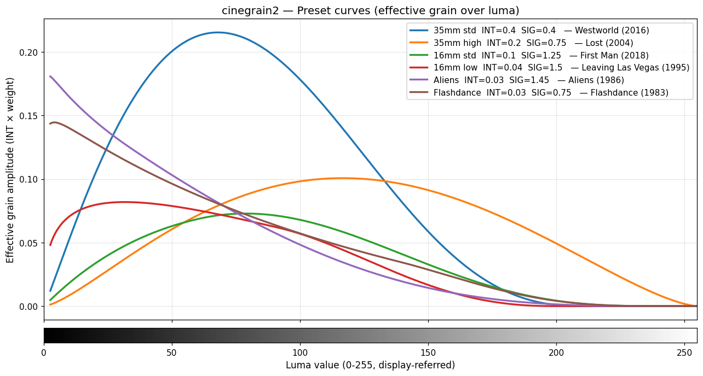](https://raw.githubusercontent.com/mr-berndt/cinegrain2/main/images/grain-curves-six-films.png)

Fun fact: Flashdance and Aliens match very closely!

The same six curves rendered as grain on a grey staircase, from black on the left to white on the right:

[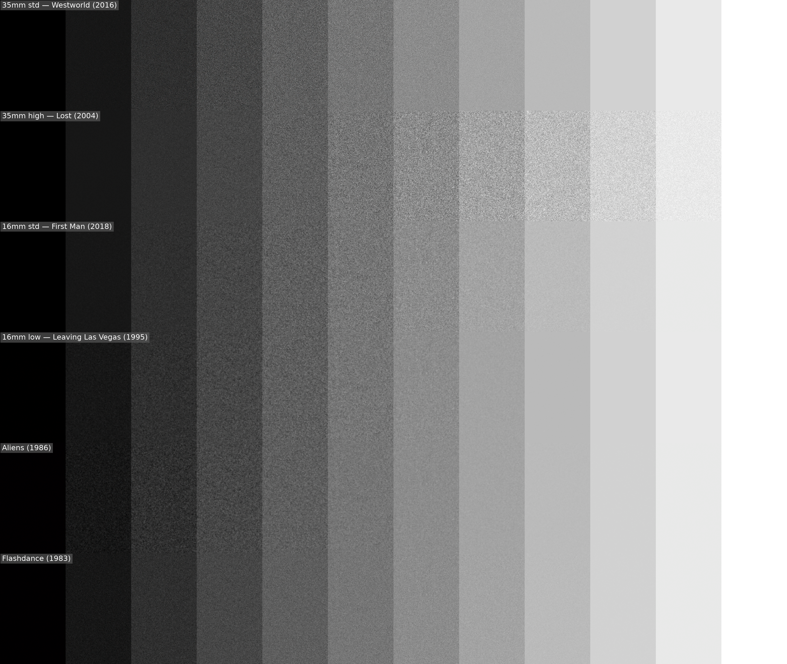](https://raw.githubusercontent.com/mr-berndt/cinegrain2/main/images/greystair-six-films.png)

A single bell curve with a peak and a width, which is what cinegrain 1 had, cannot follow shapes like these.

## The equalizer

So cinegrain 2 has a graphic equalizer with five zones:

| Zone | Brightness |
|---|---|
| Black | 0 % |
| Shadow | 13 % |
| Mid | 30 % |
| High | 60 % |
| White | 100 % |

Each zone raises or lowers the grain at its brightness, and the shader blends smoothly from one zone to the next. At 0 every zone gives the same amount of grain; −1 removes the grain in that zone completely, positive values add up to four times as much.

The equalizer sits as an overlay over the running picture and is operated with the arrow keys. A built-in grey staircase shows at any time how the grain behaves over the whole brightness range:

| Fine grain up into the highlights | Coarse grain over the whole range | Heavy in the shadows, clean on top |
|---|---|---|
| [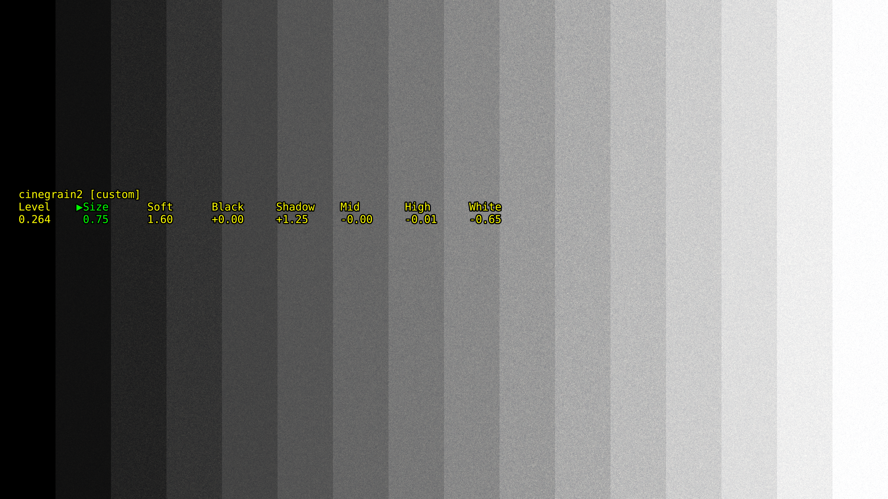](https://raw.githubusercontent.com/mr-berndt/cinegrain2/main/images/menu-greyramp-fine.png) | [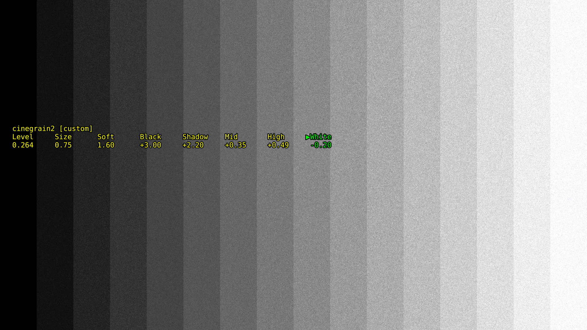](https://raw.githubusercontent.com/mr-berndt/cinegrain2/main/images/menu-greyramp-coarse.png) | [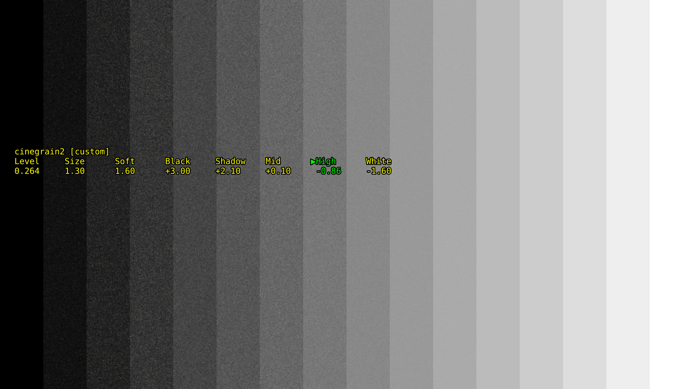](https://raw.githubusercontent.com/mr-berndt/cinegrain2/main/images/menu-greyramp-shadows.png) |

## Restoring grain that encoding took away

Most Blu-rays and many other releases still show some of their original grain, but it has visibly suffered in the encode. With the equalizer and the on/off toggle, you set size and intensity per zone until the synthetic grain exactly matches what is left of the original, and fills in what was lost. That takes about 30 seconds and brings back the original look remarkably closely.

It also works wonders on DVDs. The grain acts as dither: the picture looks crisper, and compression artefacts are masked. DVDs become pretty watchable even on large screens and projectors.

## Simpler synthesis, predictable controls

With cinegrain 1 I could imitate most grain patterns by playing with the controls, but I could not simply make the grain larger or softer and keep its character. cinegrain 2 uses a simpler synthesis: white noise, shaped by a Gaussian blur for the grain size minus a wide copy of itself, with an optional softening on top. Size and softness now behave predictably, and the grain still looks real. While comparing, I more than once mixed up which grain was real and which was synthetic. Under a microscope there are certainly differences.

---

## Installation

cinegrain 2 consists of one shader and one control script. Tested with mpv 0.40 and 0.41, with `vo=gpu-next` and `vo=gpu`.

1. Copy `shader/cinegrain2.glsl` to `~/.config/mpv/shaders/`.
2. Copy `scripts/cinegrain2-control.lua` to `~/.config/mpv/scripts/`.
3. Add the shader to `mpv.conf`, as the **last** shader in the chain:

   ```ini
   glsl-shaders-append="~~/shaders/cinegrain2.glsl"
   ```

On Windows the folder is `%APPDATA%\mpv\` instead of `~/.config/mpv/`.

The script finds the shader in the shader list by its file name, so the file may be renamed, as long as the name starts with `cinegrain2`. If the shader is missing, the overlay says so.

## Operation

| Keys | Action |
|---|---|
| `Alt+q` | grain on / off, to compare with the original |
| `Alt+←` / `Alt+→` | select the next control |
| `Alt+↑` / `Alt+↓` | change the selected control |
| `Alt+,` / `Alt+.` | previous / next preset |
| `Alt+d` | test picture: off → 50 % grey card → grey staircase |

The overlay shows all eight controls in one row, the selected one in green. It appears with the first key press and disappears 8 seconds after the last one.

### Controls

| Control | Range | Step | Meaning |
|---|---|---|---|
| Level | 0 … 5 | 0.01 | grain strength, 1.0 = as strong as a real film scan |
| Size | 0 … 3 | 0.05 | grain size (~0.4 = 35 mm, ~1.2 = 16 mm, ~2.7 = 8 mm) |
| Soft | 0 … 10 | 0.1 | softens the grain without changing its size |
| Black, Shadow, Mid, High, White | −3 … +3 | 0.05 | grain in that zone, relative to the others (−1 = none) |

Size is calibrated for 4K output and scales with the output resolution. Below 4K, fine grain is attenuated the way a 4K scan of real film would be on that display.

### Presets

| Preset | Level | Size | Soft | Black | Shadow | Mid | High | White |
|---|---|---|---|---|---|---|---|---|
| 35mm | 1.00 | 0.37 | 0.0 | 0.00 | +0.65 | 0.00 | −0.65 | −2.00 |
| 35mm heavy | 1.00 | 0.72 | 0.0 | 0.00 | +0.65 | 0.00 | −0.65 | −2.00 |
| 16mm | 1.00 | 1.16 | 0.0 | 0.00 | +0.65 | 0.00 | −0.65 | −2.00 |
| 16mm heavy | 1.00 | 1.68 | 0.0 | 0.00 | +0.65 | 0.00 | −0.65 | −2.00 |
| 8mm | 1.00 | 2.66 | 0.0 | 0.00 | +0.65 | 0.00 | −0.65 | −2.00 |

Size and Level come straight from the grain scans. The zones follow a typical film curve: more grain in the shadows, less in the highlights, none in pure white.

A preset is a starting point: as soon as a control is touched, the overlay shows `[custom]`.

### Sidecars, per film and per series

When you change the grain while a local file is playing, the settings are stored next to the video when it closes, in a small text file:

- films: `<file name>.grain`, e.g. `Aliens (1986).grain`
- series (file names with `S01E02`): `<series>.grain` for the whole series, and optionally a handmade `<series> S01.grain` for one season, which takes precedence

The next time the film or an episode is played, its grain comes back by itself. Videos you only watch get no sidecar, and streams never do. Files without a sidecar start with the last settings used.

### Options

In `~/.config/mpv/script-opts/cinegrain2-control.conf`:

```ini
# store and load .grain sidecars next to the videos
sidecars=yes
# seconds the overlay stays after the last key press
osd_timeout=8
```

### Tips for matching

1. Pause on a calm shot with a wide range of brightness: sky, faces, dark corners.
2. Switch the grain off (`Alt+q`) and look at what is left of the original.
3. Switch it on, set **Size** first, then **Level**, then shape the zones: pull down the zones where the original is clean, raise those where it is heavy.
4. Toggle on and off until you cannot tell where the original ends.
5. Check the result on the grey staircase (`Alt+d` twice).

## How it works

At the resolution of a 4K scan, every pixel covers hundreds of silver-halide crystals. By the central limit theorem, their sum is simply Gaussian noise; simulating the individual crystals, as physical grain models do, gives the same result at a far higher cost. cinegrain 2 therefore takes the shortcut:

```
crystal field        →  noise, new for every frame
optical integration  →  separable Gaussian blur, its width is Size,
                        minus a wide copy (8.4 × Size) that removes the coarse structure
display              →  amplitude scaled to what the output resolution can show
exposure             →  applied in the density domain: color × exp(Level × zone weight × grain)
```

- **Grain size.** Size is the width (sigma) of the blur in pixels at 2160p. It scales with the output height. The grain is rendered at output resolution, after all scaling, so it stays sharp whatever the source resolution.
- **Grain shape.** All ten reference scans, 8 mm to 35 mm, have the same spectrum: Gaussian-blurred noise with its coarse structure removed. The shader subtracts 0.95 × a copy blurred 8.4 times wider. The wide blur only carries coarse structure, so it is computed on a quarter-size grid; the whole grain costs about as much as the plain blur did.
- **Display resolution.** The grain we imitate is the film's own, as a 4K scan shows it. A small 1×1 pass computes, once per frame, how much of it survives on the current output: the variance of the 2160p grain after a hermite downscale (mpv's default) to the output height. At 1200p about 44 % of fine 35 mm grain remains, 87 % of 16 mm, almost all of 8 mm, which is what the real scans give.
- **Colour.** The shader samples its grain field at three widely separated offsets, which gives independent grain per channel. By default it is mixed to monochrome, like the reference scans; the shader option `CHROMA` brings colour grain back.
- **Density domain.** Grain changes the density of the silver, so it acts multiplicatively on the light. Applying it as `exp()` instead of adding it keeps blacks black and gives highlights the right amount of sparkle.
- **Zones.** The zone weight is interpolated with smoothstep between the five zones, so the curve has no overshoot. It is normalised to 1 at 50 % grey, the brightness of the reference scans, so Level keeps its meaning whatever the zones do. Black and White sit at the very ends, so −1 there removes the grain completely.
- **Soft.** An optional 8-tap ring blur with a random rotation per pixel softens the grain without making it larger, like the optical softening of small grain projected large.

### Calibration

Reference: ProRes 4K DCI grain scans of real film on a 50 % grey card, 8 mm to 35 mm, the free film grain plates from [tdcat.com](https://tdcat.com/downloads/filmgrain). For each scan, Size was fitted to its radial power spectrum by rendering the shader; Level 1.0 was set to the strength of the 16 mm scan. Grain strength measured on luma at 2160p:

| Format | Size | Level | cinegrain 2 / scan |
|---|---|---|---|
| 35 mm | 0.37 | 1.00 | 1.03 |
| Super 35 | 0.50 | 1.00 | 1.03 |
| 35 mm heavy | 0.72 | 1.00 | 1.02 |
| Super 35 heavy | 0.85 | 1.00 | 1.01 |
| Super 16 | 0.97 | 1.00 | 1.01 |
| 16 mm | 1.16 | 1.00 | 1.00 |
| Super 16 heavy | 1.42 | 1.00 | 1.00 |
| 16 mm heavy | 1.68 | 1.00 | 1.00 |
| 8 mm | 2.66 | 1.00 | 0.99 |
| 8 mm heavy | 2.66 | 1.48 | 0.99 |

All scans but one have the same strength, so Level 1.0 fits them all; the 8 mm heavy scan is simply stronger. The table is also a good starting point for Size when you know the format of a film.

What the model does not reproduce: real grain is slightly skewed towards bright values, and the 35 mm scans vary a little more in local strength than the synthetic grain. Both are hard to see.

## License

Copyright (C) 2026 mr-berndt

cinegrain 2 is free software under the [GNU General Public License v3.0](LICENSE) or later. You may use, change and share it freely, as long as anything you distribute that contains it is released under the GPL as well.

If you want to use cinegrain 2 in commercial or closed-source software that cannot be released under the GPL, please ask me first by [opening an issue](https://github.com/mr-berndt/cinegrain2/issues) - a separate license is possible.

Versions up to commit `fd9e8f3` (12 October 2026) were published under the MIT license.
